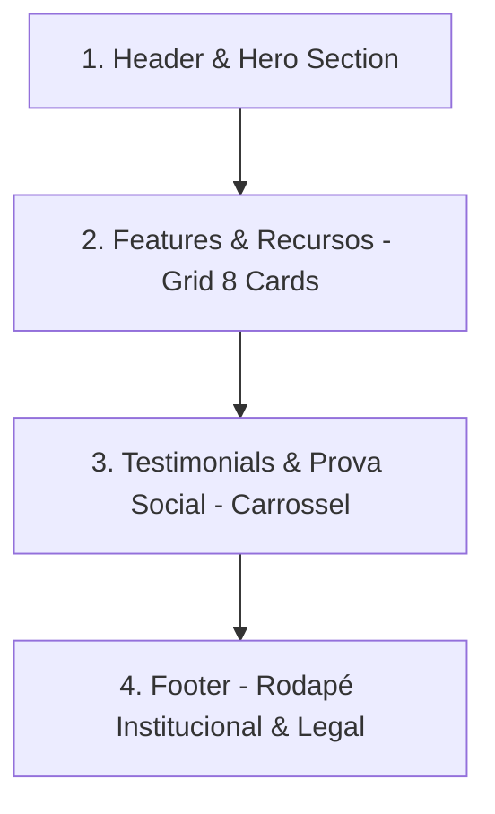

# 🚀 Desafio DIO: Criando um Wireframe de Média Fidelidade (One Page)

Projeto desenvolvido como entrega prática do desafio da **Digital Innovation One (DIO)** focado em Arquitetura da Informação, Psicologia do Design e Usabilidade aplicada a interfaces digitais.

---

## 🔗 Link do Projeto no Figma

> 📌 **Acesse o Wireframe no Figma:**  
> [**Clique aqui para visualizar o projeto no Figma**](https://www.figma.com/design/H7slEKgtdE61iHbbghEFfI/Wireframe-M%C3%A9dia-Fidelidade---DIO?node-id=0-1&t=027qOMwRYV6Zxso2-1)  
> *(Permissão configurada: "Qualquer pessoa com o link pode visualizar")*

---

## 🎯 1. Visão Geral do Produto

* **Nome do Produto:** **Simplifique AI**
* **Segmento:** SaaS / Automação de Processos & Atendimento com Inteligência Artificial
* **Proposta de Valor Única (UVP):** Conectar empresas e profissionais a fluxos de automação inteligentes no WhatsApp, planilhas e e-mails de forma rápida, intuitiva e sem complexidade de programação.
* **Formato da Interface:** **One Page (Landing Page contínua de alta conversão)** com navegação fluida em rolagem vertical.

---

## 📐 2. Estrutura da One Page (Arquitetura da Informação)

O wireframe de média fidelidade foi estruturado em 4 blocos fundamentais empilhados verticalmente:

### 1. Header & Hero Section (Apresentação de Alto Impacto)
* **Logotipo & Navegação Global:** Posicionados no topo para reconhecimento imediato de marca e categorias de navegação.
* **Headline & Subtitle:** Título claro comunicando a proposta de valor, seguido de texto de apoio contextual.
* **Call to Action (CTA) Primário:** Botão destacado com contraste visual para direcionar a conversão do usuário.
* **Mockup do Produto (Laptop):** Demonstração visual do ecossistema da aplicação para tangibilizar o serviço.

### 2. Features & Benefícios (Grade de Capacidades)
* **Estrutura:** Grade equilibrada com 8 blocos de recursos categorizados com ícones e microtextos explicativos.
* **Objetivo:** Responder rapidamente às principais dúvidas sobre funcionalidades sem sobrecarregar a memória de trabalho do visitante.

### 3. Testimonials & Prova Social (Geração de Confiança)
* **Estrutura:** Carrossel interativo com citação de clientes, foto do usuário (*avatar*) e controles de navegação `< >`.
* **Objetivo:** Reduzir a fricção de compra e validar a eficácia da ferramenta por meio de depoimentos reais.

### 4. Footer & Rodapé (Encerramento & Segurança Legal)
* **Estrutura:** Faixa institucional contendo Direitos Autorais (`© 2026 Simplifique AI`), Termos de Uso e Política de Privacidade.
* **Objetivo:** Fornecer credibilidade legal e fechar a experiência da página de forma organizada.

---

## 🧠 3. Leis de Usabilidade e Psicologia do Design Aplicadas

### 🎯 10 Heurísticas de Jakob Nielsen
1. **Visibilidade do status do sistema (Heurística #1):**
   * Elementos interativos (botões de ação e setas de navegação do carrossel) possuem pesos visuais definidos, antecipando o feedback de clique.
2. **Correspondência entre o sistema e o mundo real (Heurística #2):**
   * A metáfora visual do notebook e celular tangibiliza que o software funciona em dispositivos que o usuário já utiliza no cotidiano.
3. **Consistência e Padrões (Heurística #4):**
   * Padrão consagrado da web: Logotipo no canto superior esquerdo, links no centro/topo e rodapé com direitos autorais na base da página.
4. **Reconhecimento em vez de recordação (Heurística #6):**
   * Ícones circulares acompanhados de legendas explicativas nos blocos de benefícios garantem que o usuário não precise memorizar instruções.
5. **Estética e Design Minimalista (Heurística #8):**
   * Padrão de **Média Fidelidade** em escala de cinza neutra, eliminando ruídos decorativos e focando exclusivamente na hierarquia de conteúdo, leitura e usabilidade.

---

### 🏛️ Critérios Ergonômicos de Bastien & Scapin
* **Condução (Guidance):** Agrupamento visual das seções por meio de espaços em branco (*whitespace*), guiando os olhos do leitor do topo ao fim.
* **Carga de Trabalho (Workload):** Textos sintetizados e títulos diretos, minimizando a densidade informacional e a fadiga cognitiva.
* **Homogeneidade / Consistência:** Tipografia padronizada em escala modular e alinhamentos milimétricos entre blocos.

---

### ⚡ Psicologia Cognitiva de Interfaces
* **Lei de Hick:** Redução do número de botões principais para acelerar a tomada de decisão do usuário.
* **Lei de Fitts:** Botões de ação (*CTAs*) com área de clique ampliada para facilitar o acionamento em telas de computador ou toque.
* **Leis da Gestalt (Proximidade & Continuidade):**
  * *Proximidade:* Títulos, descrições e botões agrupados em blocos lógicos.
  * *Continuidade:* Alinhamento vertical centralizado estimulando a rolagem natural da página.

---

## 🛠️ Tecnologias e Ferramentas Utilizadas

* **Figma Desktop:** Criação e modelagem vetorial do wireframe no padrão 1440px Desktop.
* **Wireframe Plugin (Community):** Utilização de componentes modulares padronizados.
* **Markdown & Mermaid:** Documentação e diagramação da arquitetura da informação.

---

## 👨‍💻 Autor

* **Pedro Barros** — Simplifique.IA
* Projeto submetido para avaliação no bootcamp da **Digital Innovation One (DIO)**.

